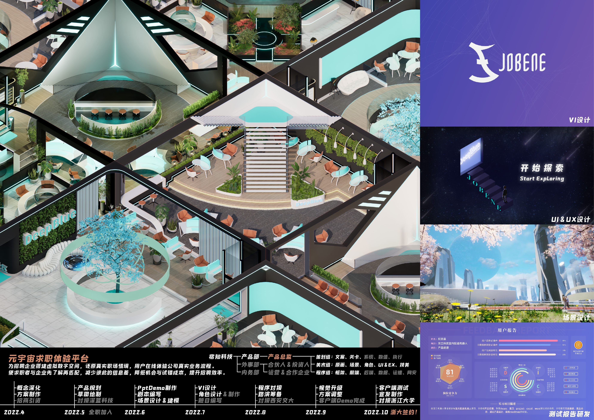
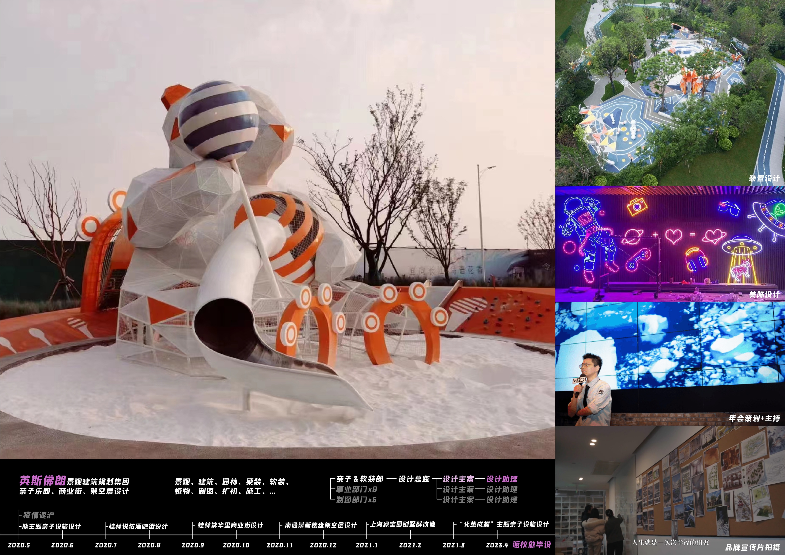
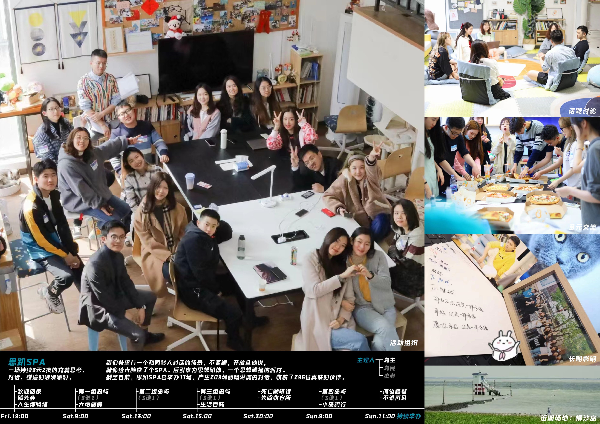
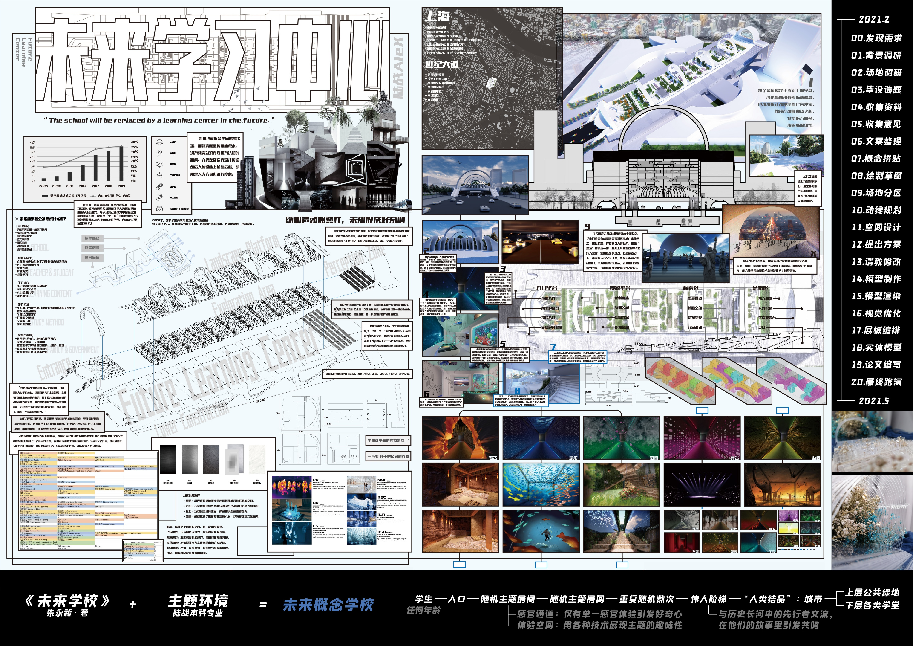
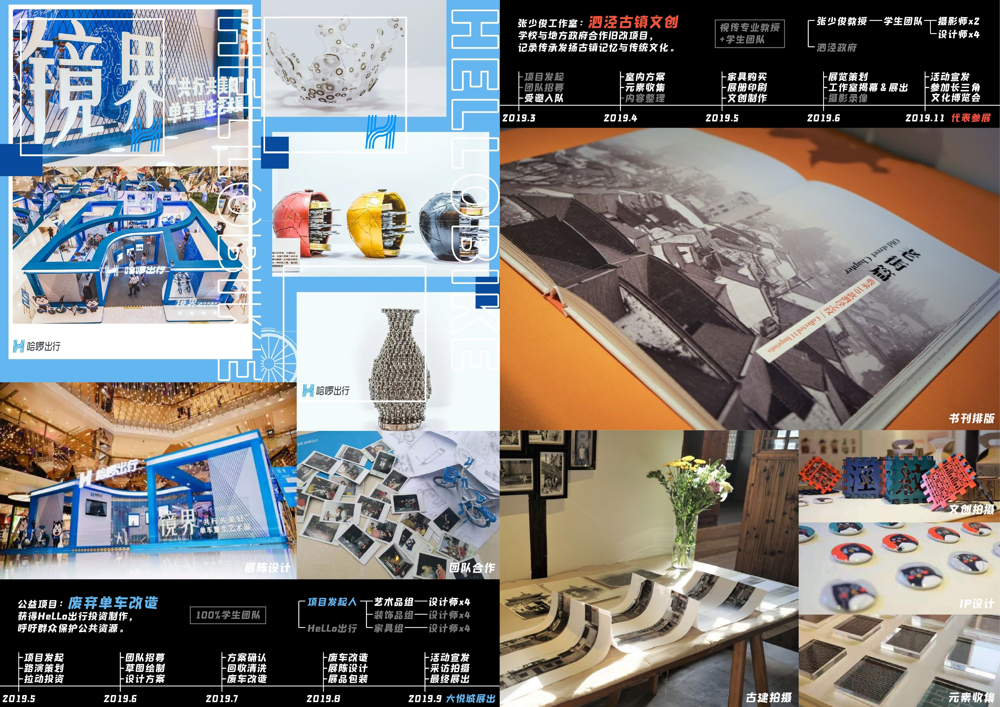
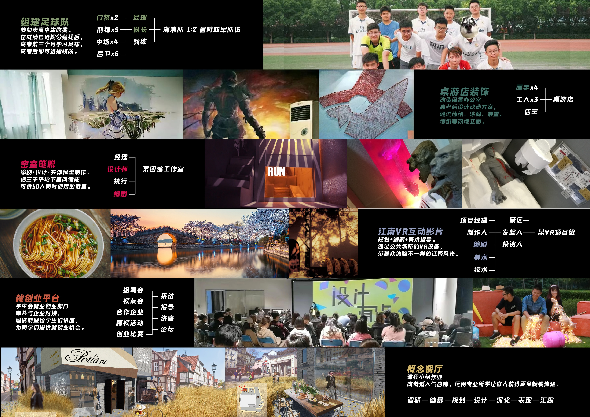

# 陆战作品集 2023

[下载原始 PDF](https://github.com/958344569/luzhan-portfolio-2023/releases/download/v2023/luzhan-portfolio-2023.pdf) · [打开 Figma 演示](https://www.figma.com/proto/6duxETraRQohKEbZBHNHX2?node-id=1-2&page-id=0%3A1&starting-point-node-id=1%3A2&scaling=min-zoom)

共 9 页，按原始顺序展示。下方预览图片保留作品集的原始排版与字体效果；PDF 为原始文件，可下载查看完整内容。

### 第 1 页

### 第 2 页

### 第 3 页

### 第 4 页

### 第 5 页

### 第 6 页

### 第 7 页

### 第 8 页

### 第 9 页

